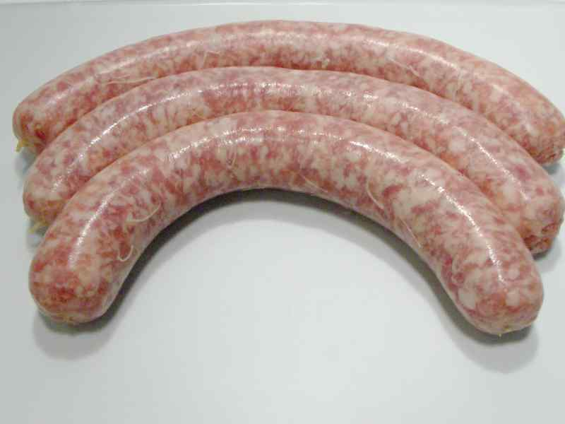
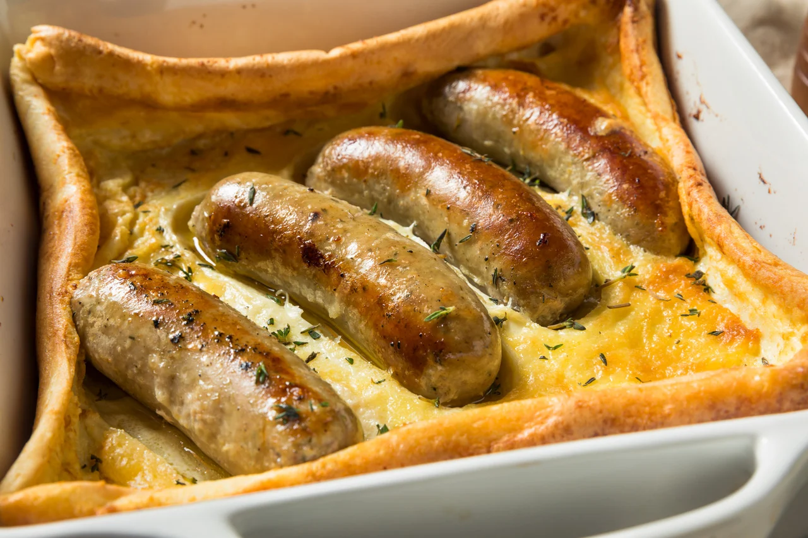

A few days ago, I was watching an interview of a cook with a farmer that grows pigs to produce meat. Now I must confess that I once did eat meat, but I've been a vegetarian for the better part of my life (over 25 years). It isn't a topic I care to listen to in general, but the interview was for a show that often discusses healthy lifestyles, people that do wonderful things for nature, so I stuck around for a while.

## The great deception

In a way, the interview was quite interesting. The farmer, a woman that clearly cares about nature and life, explained how they kept the pigs. They have a lot of room, can be outside all the time, are fed well, and taken care of well as far as I can tell.

It is a feel-good interview. We can all see the little piglets running around their mothers, having fun in a nice environment, not a barn filled to the max with livestock.

The interview took an interesting turn at some point, as in this show there is always a cook doing the interviews, and he proceeds to make a meal out of the things in nature he can find at the place of the person being interviewed. To explain, this cook can also interview a vegetable or almond farmer, just anything related to nature.

The cook went off to create this dish and opted to cook something with a large pork sausage (to be clear, they didn't slaughter anything at that time). I watched in fascination and then I realised that our meat industry turned this:

into this:

## The result was lovely and very tasty

The interview always ends with the cook serving the dish that contains something of the farm, and in this case, it turned out to be toad in a hole, made with fresh and natural ingredients. The farmer enjoyed the meal and thought it was very tasty.

At this moment I thought, without moral judgement, here is someone who truly wants to do things right, to care for the animals she grows, and to ensure they have a good life (that is something often said in marketing of meat). And yet, you cannot escape the inevitable, that the pig was turned into a sausage and eaten by a human being.

It is this deception that I never understood. Does it really matter how we treat our animals before we slaughter them for food? I mean, of course it does. But does it really? The result is the same, a pig turned into a product turned into a toad in a hole.

## Animal versus product

I understand that humankind has always hunted animals for food. But there is something terrifying about a society that has created a super-efficient process to grow and slaughter animals, only for them to become a product in a supermarket. I feel we have lost something in that transition. We've lost a bit of our humanity when we started doing this on such a large scale. And then, it really doesn't matter if the animal had a good life or not. The moment we talk about animals as products, is the moment we all lose something.

What does matter, is that there is an alternative possible. A world in which we all decide to eat much less, and perhaps eventually, no more dead animals. The implications would be tremendous. It would reduce climate change, animal suffering, reduce water and food shortages, increase health, and perhaps even make us all feel a little better about ourselves.

I'll never try to force my decision to stop eating dead animals on another. But by talking about it, I do hope that more people will start experimenting with it. There are so many lovely and tasty alternatives now. It seems to slowly change and become less of an oddity (people used to laugh at me, or more interesting get angry with me for not eating meat).

It is easy to try it out and it might make you feel better in many ways.

#personal #meat #vegetarian
