In a previous post I discussed creating [web components using ClojureScript](https://avanelsas.github.io/foggy-glasses/web-components-in-cljs/) and besides some of the advantages of web components I mentioned that there are some clear downsides as well. Web components aren't easy and for a component framework user it takes some mental gymnastics to wrap your head around the API.

I wanted to learn about web components, ended up creating a web component library called BareDOM, and then expanded my knowledge of how to use web components by creating projects that use web components. I created BareBuild, a small ClojureScript runtime that supports server-state UIs, which comes with a very nice and powerful time-travel replay debugger called BareReplay. And of course, since everything is written in CLJS I ended up creating a bit of nREPL support to probe your web component implementation called BareProbe.

I also tried to read up quite a bit on web components. Lots of opinions on them, from amazing to amazingly bad. A lot of the criticisms come from the problem that web components really are quite low level and that the browser platform doesn't really offer ways to deal with the challenges mentioned in this article. That is where frameworks shine, and that is also a problem as one of the promises web components give is that you are not tied to a specific framework. I started working on these challenges, and that is how BareMirror came about.

I will try to explain some of these challenges and show how they can be addressed using [BareDOM](https://github.com/avanelsas/BareDOM). I have created [^footnote1] a small set of functions inside that repository, called [BareMirror](https://github.com/avanelsas/baredom/blob/main/baremirror/README.md), that addresses some of these issues. Although BareMirror works well with BareDOM, there is no reason it cannot be used for other web component libraries. And although it is written in ClojureScript, it ships as a plain ES module for JavaScript and TypeScript.

Here are some of the major challenges with web components.

### 1. DOM rebuilding destroys UI state

A common problem with an application rebuilding its HTML is that its existing DOM nodes are replaced. The result of this is that it destroys things like input focus, text selections, scroll positions, ongoing animations and even internal web component state.

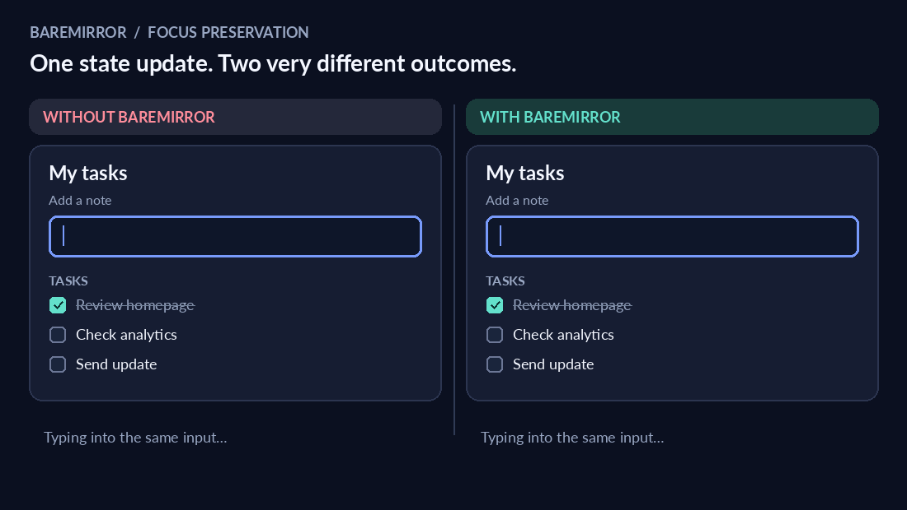

In the animation above you can see how the focus is lost when the component is rebuilt on the left side, and what happens if you address that issue properly. What needs to be done is to reuse existing keyed nodes, preserve the focus, selection, scroll position and component state.

### 2. Updating the DOM manually is complicated

While it is entirely possible to update the DOM yourself, it is a complex task. You need to find DOM elements, insert nodes, remove rows, and update attributes. As the complexity of your app increases, this task becomes more difficult to maintain. And if you get it wrong, the interface can display stale state. A targeted update has preference here.

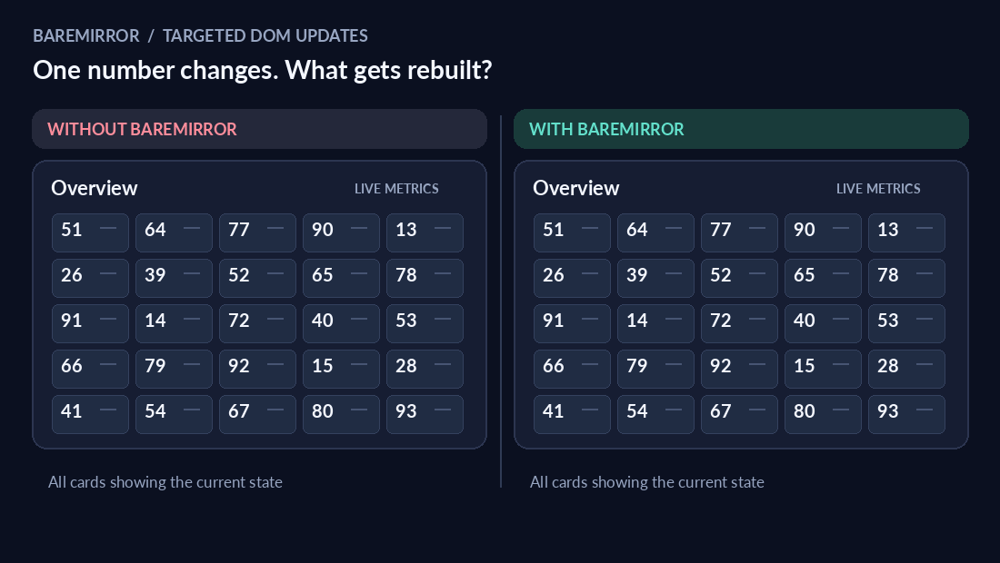

On the left side the entire calendar view is rebuilt, while on the right only the one value is updated.

### 3. Unnecessary DOM updates hurt performance

The easy solution for re-rendering a page is to do the entire page. But this comes at a cost, especially when the page has complex components or large lists. Instead of re-rendering everything we can compare the last written values to the new values and then only update the attributes that have changed. Unchanged items receive no writes.

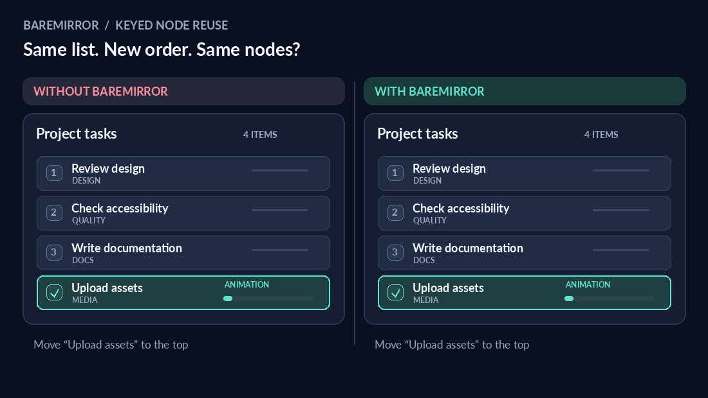

Adding, deleting, reordering list items require deliberate DOM operations. Again, the simple solution is to rebuild it, but that loses state and node identity. A better solution is to add stable keys to each DOM node so that insert, remove and move operations to desired positions in the DOM become much easier to accomplish.

### 4. Component state and server state can disagree

There are numerous ways in which component state and server state can disagree. An example is a web component asking the server for a state change that is rejected by the server. If there is no coordination, then the web component might show a value rejected by the server. The chosen solution is that the component asks, the app decides, and the component only shows what the state holds.

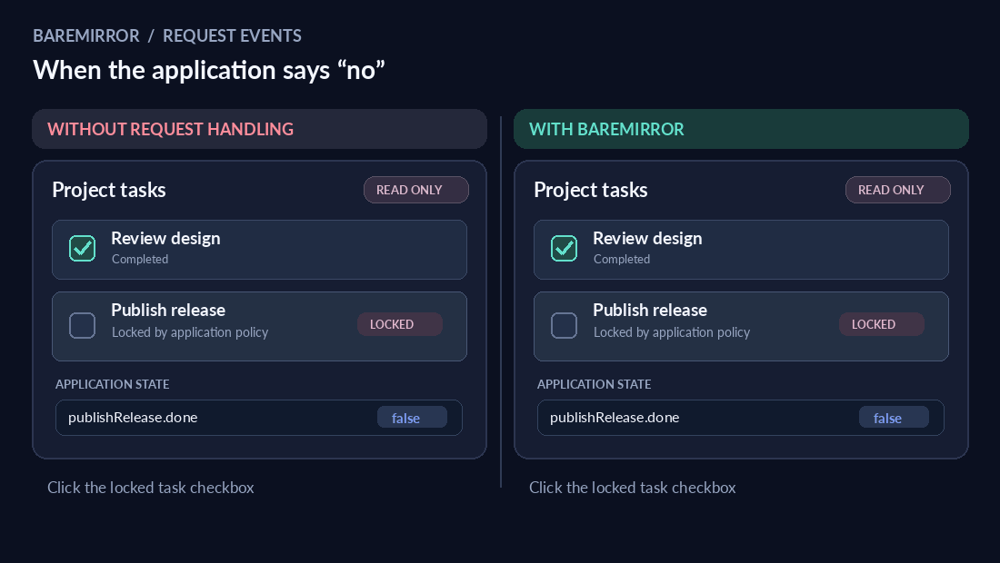

### 5. Event handling requires both DOM knowledge and boilerplate

If you are implementing event handling, you need to write some boilerplate code to find what needs to be done and ensure it is taken care of. In BareMirror events are translated into declarative messages that contain both the action to be taken and the key of the row. The result is a standardised way to handle events.

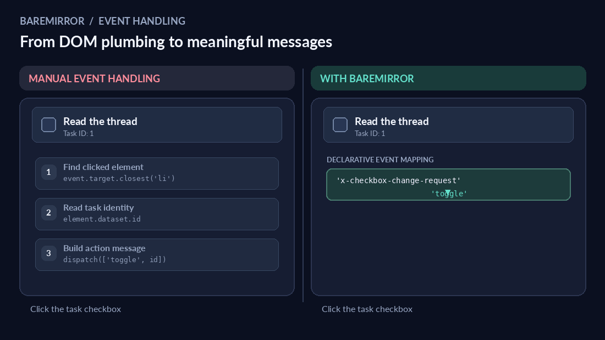

### 6. Frameworks introduce architectural dependencies

One of the main reasons to use web components is that it doesn't tie you to a framework. You use the browser platform and can therefore keep bundle size small and reuse the components in whatever framework you want to use. There is a simple reason that frameworks are popular, they solve problems that a web component does not even begin to address. However, if we look at these rendering challenges it turns out that most of them can be resolved with a relatively small set of functions. Updating is simpler when there are fewer things to update.

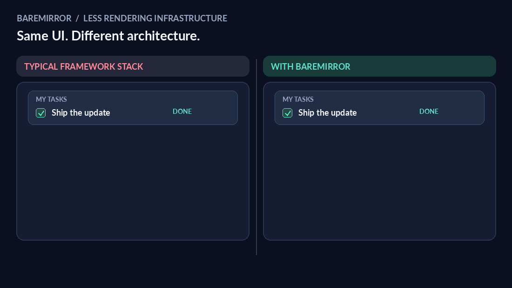

## What BareMirror does to resolve these issues

BareMirror is a small set of functions that bring a page to what your application wants to show. The app keeps the state. The functions place the nodes, write the values and turn events into messages. It does not compare an old screen with a new one, just keys, and a node that stays is never made again. BareMirror only remembers what it wrote, on the nodes themselves. Each node holds a key, the item last written to it and the value last written to each of its properties.

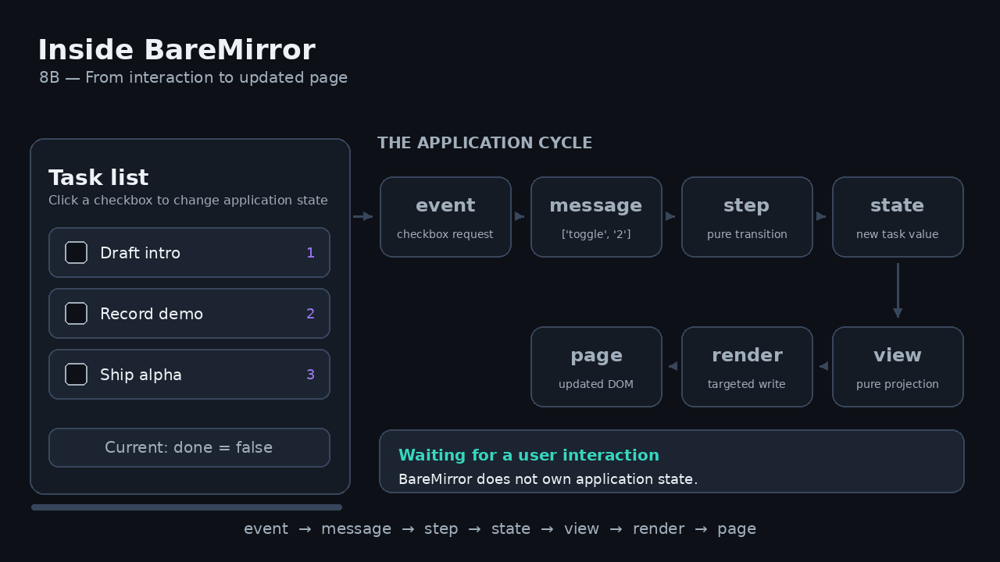

### A cycle of 7 steps

It works using a standard cycle of seven steps (event, message, step, state, view, render, page). It starts with an event (e.g. a user interaction), transforms it to a message that goes into a pure step function. The step function determines what the message does to affect state. From there we get the new state, put it into a view projection and then use a targeted write to update the DOM only there where it is needed.

### Focus on data instead of another DOM

Instead of creating and keeping a second DOM tree somewhere in memory, BareMirror focuses on the data model. The basic idea is to keep track of a marked node called a part. A key marks the node in a list. Second, it defines templates, a fixed shape of a node that keeps track of where dynamic values can be written. These places are called holes, and that is where targeted writes can then be aimed at.

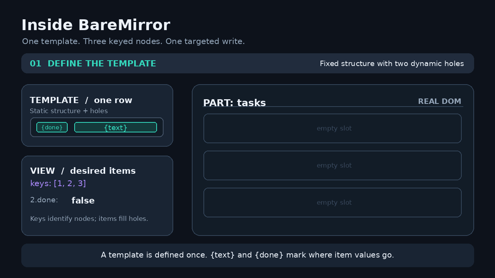

In the example above you can see a list of items where one of them is selected. BareMirror locates the node, looks at the template and fills the hole with a new value via a targeted write.

The entire process is implemented in a set of functions that add about 7KB[^footnote2] to a bundle. Instead of going through the code line by line, I will highlight a few elements to give you a feel for what it does.

### Templates

One core element is to create templates from data once, at the start. Instead of comparing old to new, we create templates with fixed and dynamic elements (holes).

Example:

```clojure
[:li
 [:x-checkbox {:checked :done? :on {"x-checkbox-change-request" :toggle}}]
 [:span :text]
 [:x-button {:on {"press" :remove}} "Remove"]]
```

Here is a row with html elements and web components. We use `template/split` to generate the template for this. It will create the following data structure:

```clojure
{:fixed  [:li
          [:x-checkbox {:data-x-part "row.0"}]
          [:span {:data-x-part "row.1"}]
          [:x-button {:data-x-part "row.2"} "Remove"]]
 :holes  [{:part "row.0" :attrs {:checked :done?}}
          {:part "row.1" :text :text}]
 :events {["x-checkbox-change-request" "row.0"] :toggle
          ["press" "row.2"] :remove}}
```

As you can see, fixed items do not need a name, but things that can change do get a name. A hole is just a function of the item. In Clojure a keyword is a function so `:done?` is just a function that can be used on item `(:done? item)`. An event uses the part name of its node to allow single map lookups.

From this we can write helper functions to figure out where we need to write new values.

```clojure
(defn- fill [item hole]
  (hole item))

(defn- hole-writes
  "The part name of `hole` and its writes for `item`."
  [item {:keys [part attrs text props]}]
  [part (cond-> {}
          attrs (assoc :attrs (update-vals attrs (partial fill item)))
          text  (assoc :text (fill item text))
          props (assoc :props (update-vals props (partial fill item))))])

(defn writes
  "The writes of `item` for the holes of `split-template`, by part name."
  [split-template item]
  (into {} (map (partial hole-writes item)) (:holes split-template)))
```

For the item `{:done? true :text "Buy milk"}`, the writes function gives `{"row.0" {:attrs {:checked true}}, "row.1" {:text "Buy milk"}}`.

And then there is the `parts/write-parts!` function that does the actual writing. It looks like this:

```clojure
(defn- write-part!
  "Applies the write of one part to its node: the text, then the attributes, then the
   properties."
  [parts [part-name {:keys [attrs props] :as write}]]
  (let [node (parts part-name)]
    (when (contains? write :text)
      (set-text! node (:text write)))
    (when attrs
      (set-attrs! node attrs))
    (run! (partial set-prop! node) props)))

(defn write-parts!
  "Applies `writes` to `parts`, which are maps by part name: the nodes as `read-parts` gives
   them, and `:text`, `:attrs` and `:props` as `template/writes` gives them. A property is
   written when its value differs from the value last written to it, as `same-value?` sees it.
   Throws before any write when a part name has no node."
  [parts writes]
  (when-some [missing (seq (missing-parts parts writes))]
    (throw (ex-info "write-parts!: no node has these part names." {:parts (vec missing)})))
  (run! (partial write-part! parts) writes))
```

Note that writes only happen if a value, an attribute or property has changed.

### Plans

The next idea is to use a standard set of steps to determine what needs to update with a change. That is done with plans.

```clojure
(plan/plan {:todo ["a" "b" "c" "d" "e"]}
            {:todo ["a" "d" "b" "c" "x" "e"]})
 ;; => {:remove []
 ;;     :place  [{:key "x" :in :todo :before "e"}
 ;;              {:key "d" :in :todo :before "b"}]}
```

In the example above you see how the plan function takes an old and a new situation and determines how to get from old to new. There are only two basic operations, remove, and place. Insert and move are both a place. A key with no node gets a new one, and a key that already has a node keeps it.

Plan says where a node needs to go if it requires some form of update. The code looks like this:

```clojure
(defn- placements
  "The placements that turn `current` into `wanted` in one container, in the order to perform them.
   The keys that both share at the start and at the end are left alone."
  [container current wanted]
  (let [[head tail :as ends] (shared-ends current wanted)
        stays                (longest-rising (ranks (middle current ends) (middle wanted ends)))]
    (into []
          (comp (remove (partial stays-at? stays head))
                (map (partial placement container wanted)))
          (range (- (count wanted) tail 1) (dec head) -1))))

(defn- container-placements
  "The placements for `container`, which either side may leave out."
  [current wanted container]
  (placements container (vec (get current container)) (vec (get wanted container))))

(defn plan
  "What must happen to turn the `current` places into the `wanted` places.
   Both map a container to its keys, in order. A key is in at most one container."
  [current wanted]
  (if (= current wanted)
    {:remove [] :place []}
    (let [wanted-anywhere (among (vals wanted))]
      {:remove (into [] (comp cat (remove wanted-anywhere)) (vals current))
       :place  (into []
                     (mapcat (partial container-placements current wanted))
                     (distinct (concat (keys current) (keys wanted))))})))
```

Again, note that the code tries to avoid updating anything that doesn't change. The `placements` function needs some explanation. BareMirror keeps children in line with a list of keys. It tries to find the fewest DOM moves to get from a current to a wanted situation. Example: A list of child keys might look like `[a b c d e]` and the new order wanted is `[a d b c x e]`. Placements performs 4 steps.

1. Trim the shared ends. Changes often happen somewhere in the middle. In this case keys that already match at the start (a) and at the end (e) are left alone. That leaves `[b c d]` now and `[d b c x]` wanted.
2. Rank the middle. Each wanted key gets its position in the current middle, e.g. `[d b c x]` becomes `[2 0 1 nil]`, where nil means the key isn't in the list yet.
3. Keep the longest increasing subsequence. The longest series of ranks going up, not necessarily side by side is `0 1`, which is `[b c]`. These keys are already correctly placed, so they stay put, which leads to fewer moves needed.
4. Place the rest back to front. Each remaining key is put before its right-hand neighbour in the wanted list. `x` goes before `e`. `d` goes before `b`. etc. Going backwards guarantees that neighbour is already at the right place.

Keys no longer needed are not placed but removed. All of this is planning. It doesn't really change anything, it only computes what needs to change. It is a pure function so there are no side effects to worry about.

Placing nodes takes three steps. `read-places` reads the current keys from the DOM, `plan` compares them with the wanted keys, and `perform!` carries out the plan. It inserts and moves only the nodes the plan names and removes the dropped ones, and every node that stays is left untouched.

## Demos

The code comes with several demos, but the mirror demo shows a lot of what BareMirror provides. It splits the screen into 2, on the left side a JS implementation of a task list, and on the right the same task list but now implemented with BareMirror.

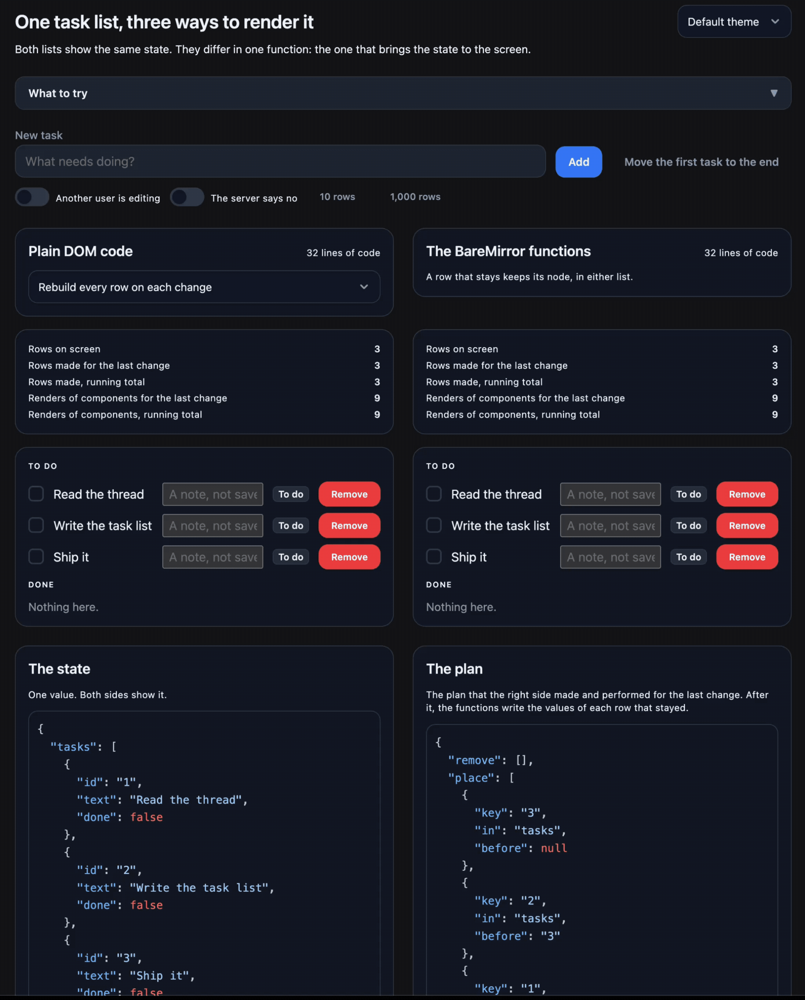

Notice that any manipulation of a task leads to a full update (flashing colors) on the left, and a dedicated update on the right.

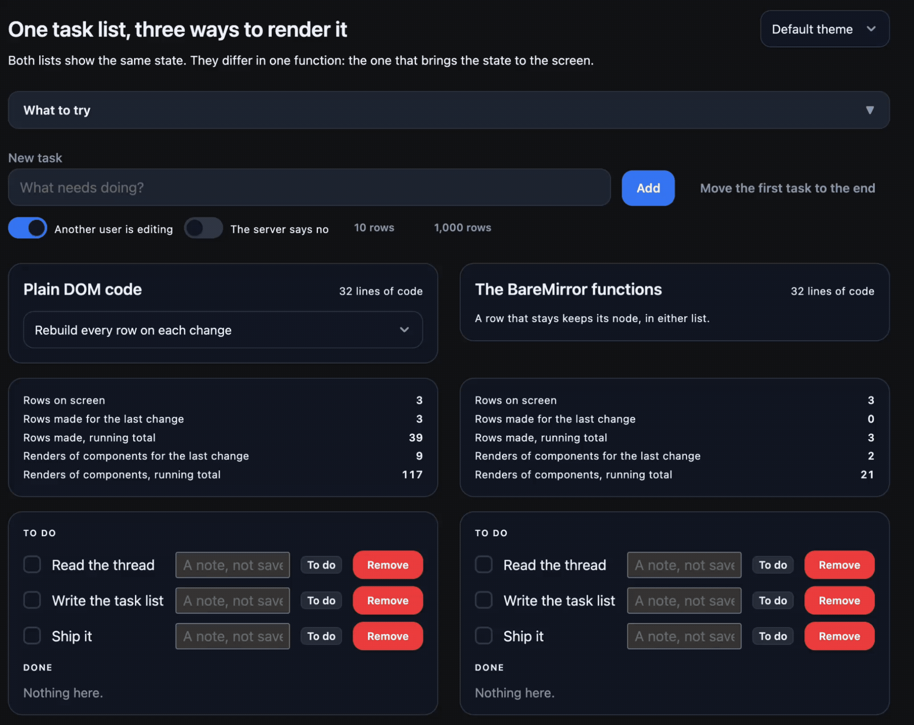

Another interesting thing is to note that when another user is manipulating the same task list you lose focus in the note input field. This can be prevented by not recreating the node that has focus, but keeping it.

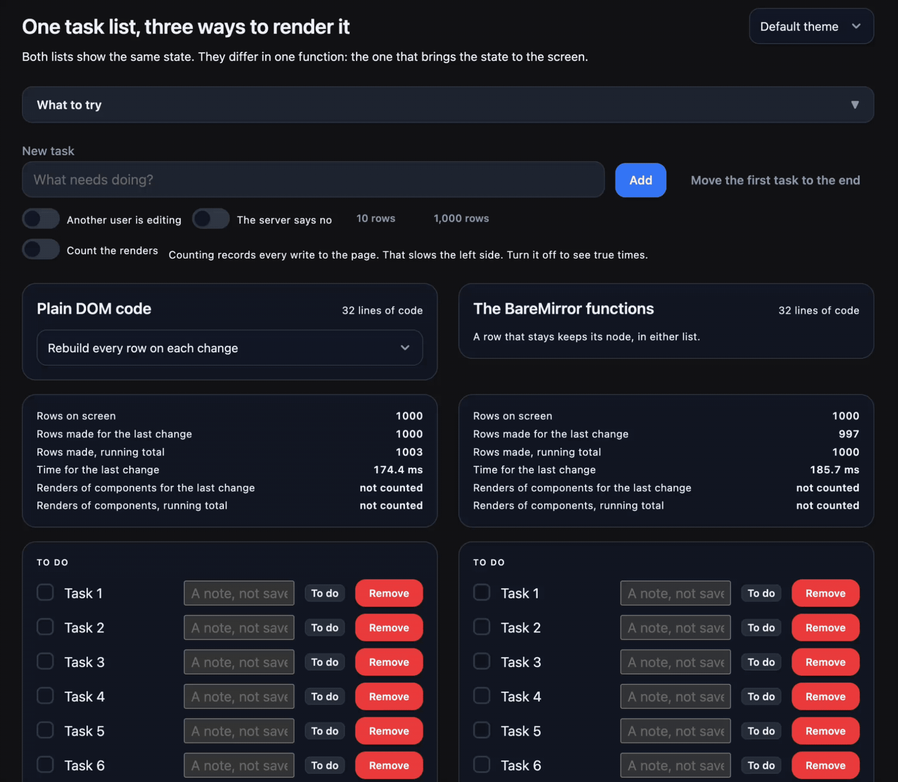

If we increase the number of tasks to 1000 then the constant re-rendering becomes an issue. Just look at the time it takes to update the left versus the right.

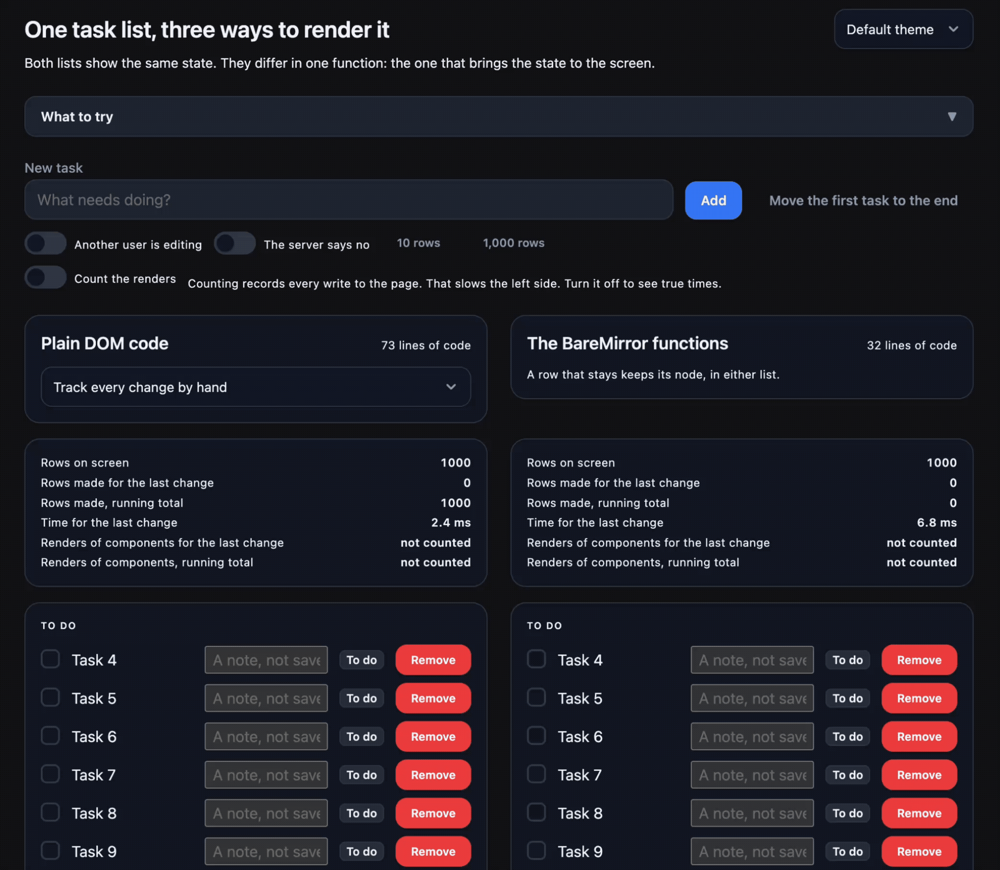

Re-rendering the entire page is naive. We can implement re-rendering by hand to speed things up, so when we switch the left side to optimised handwritten code, it updates faster than the right side. The point isn't that you cannot do all these things yourself, but that it is a lot of work to keep doing this by hand.

## What about Lit?

[Lit](https://lit.dev/) is a mature solution and offers most of the things you could want when dealing with web components. Lit uses a slightly different approach than BareMirror to solve these rendering issues. Lit remembers what it rendered last in memory. It compares against its memory and then updates the DOM. It never reads the DOM back, which makes it faster.

BareMirror keeps no such memory or state outside the DOM. It reads the DOM on every render, which makes the DOM the only source of truth. Although this is slower, the most important advantage of this approach is that whatever must change is just a value that you can inspect before it reaches the DOM. It is also likely to be a bit faster when you are moving heavy rows from one list to another. Lit will destroy the node and create a new one, BareMirror won't.

We can compare performance of Lit versus BareMirror with the 1000 row demo, by performing tasks on them and then measuring how long it takes. First a comparison using BareDOM web components:

| Operation           | BareMirror (ms)| Lit 3.3.0 (ms) |
|:--------------------|:--------------:|----------:|
| create 1000         |          109.2 |      91.2 |
| rotate one          |            1.7 |       1.0 |
| toggle one          |            1.2 |       0.6 |
| toggle every 10th   |           13.0 |      10.6 |
| rename every 10th   |            1.9 |       1.2 |
| swap rows 2 and 999 |            1.4 |       0.7 |
| remove one          |            0.7 |       0.3 |
| replace all 1000    |          121.1 |     100.8 |
| clear               |            9.9 |       8.7 |

To exclude any overhead of BareDOM we can do the same benchmark with plain html elements:

| Operation           | BareMirror (ms)| Lit 3.3.0 (ms) |
|:--------------------|:--------------:|----------:|
| create 1000         |           20.6 |      17.8 |
| rotate one          |            1.3 |       0.4 |
| toggle one          |            0.7 |       0.3 |
| toggle every 10th   |            3.3 |       2.4 |
| rename every 10th   |            1.3 |       0.6 |
| swap rows 2 and 999 |            0.8 |       0.3 |
| remove one          |            0.6 |       0.2 |
| replace all 1000    |           23.6 |      20.4 |
| clear               |            3.0 |       2.3 |

Not bad for a first attempt, but Lit is clearly the more mature and faster solution for these challenges.

## Status

The BareMirror code is still alpha and therefore in the BareDOM repo for now. It works as is, and it is used in several other projects, including in an open-source blog generator called [BareBlog](https://github.com/avanelsas/bareblog) (which powers this blog).

I hope that this helps to make web components a little more useful in your app development.

[^footnote1]: disclaimer: I use Claude Code to brainstorm, plan, and help with writing code and tests for both BareDOM and BareMirror.
[^footnote2]: Gzipped, on a page that loads BareDOM. Without BareDOM it costs about 78KB, because it loads BareDOM's shared base.js.

#web_components #BareMirror #Lit #rendering #frameworks #BareDOM #JavaScript #ClojureScript
