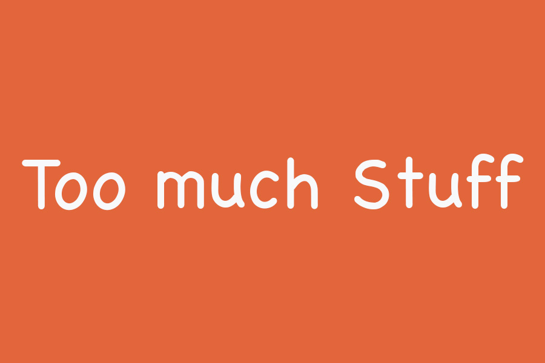

# On ethical lines, morally abject software, too much stuff and life

The world I am confronted with professionally seems to be divided in two. Either you use LLMs to do a job, or you reject them. I've noticed that the people rejecting them believe that it should be rejected on both moral and ethical grounds. The people that use them often seem pragmatic, are forced to use them by their employer, or really love creating stuff with them.

I find it difficult to navigate this new world with these opposing views. Not only because the arguments are versatile and complex but also because emotion plays a big role in these discussions. I was reminded of this when reading an [article](https://azhdarchid.com/big-balk/) where the author uses words like *morally abhorrent software systems* and *ethical boundaries* in relation to the use of LLMs.

I find that I agree with most of these views and arguments. At the same time, I have used LLMs to do code reviews, write code, and in general get things done, both professionally and personally. I find myself struggling with the argument that something like this is 100% bad (or 100% good for that matter). What does that say about me?

I do not have that moral or ethical struggle with things like discrimination, war, crimes against humanity, lying and cheating, the way we treat our environment. There it seems clear to me what is right and what is wrong and how I feel about that.

## The negative

With this LLM stuff I find I struggle to draw a straight line or take up a strong position either way. I get the argument that it has an environmental impact, that there are only a few, possibly deranged, CEOs in control of this tech. That it might lose a lot of people their job, that it can lead to slop and dumbed down people, that it works because the companies have stolen intellectual property to train models, etc. These are all valid sentiments and arguments against the use of LLMs.

## The "positive"

And yet I use LLMs to solve problems I cannot easily fix any other way. The ethical and morally justified choice would be not to use LLMs. Which implies I probably should not use Google, Microsoft or Apple products either. Or services that reduce worker conditions like Uber (I don't use it). In general, technology is actively used to automate people's jobs away, so writing software becomes an ethical dilemma. I've grown up with technology, went to university to learn software engineering, have used and built technology in all my professional life.

Does that make me a morally abject person? An unethical idiot that blindly follows the billionaires trying to control the world? Questions I can ask myself but do not have a satisfying answer for. And do these answers change if I use an open source model instead of a paid service?

There are so many other things to worry about that it seems to me, and yes this is an easy way out, that this discussion sometimes feels futile to me.

## So many other dilemma's

For example, we worry about the environmental impact of data centers, and yet every day we are willing to grow and slaughter billions of animals for food. The impact of this business on our environment dwarfs the impact data centers have on our environment.

To give you an idea, a kilogram of beef requires some 17 thousand liters of water. It occupies almost 3 quarters of all agricultural land on earth. It is responsible for global deforestation, the loss of biodiversity and a huge emission of carbon dioxide, polluting our world. The way we treat animals as product and food is unethical in so many ways that I can't even begin to describe them.

We take a car or a plane to work. We go on cruise ships, use a computer and other electrical devices for work and play. We buy stuff in China, only to have it shipped to our homes, because it is cheap and convenient. Never mind the environment.

We allow grifters, liars, cheats and racists to run our countries. And we see CEO's having affairs as just another day at the office, instead of viewing it for what it is. There are a few people on this world that have more money than an average country can spend. And that easily spend a billion here or there to buy election results.

We see power hungry rulers start wars, commit crimes against humanity, and we often don't seem to care. Sure, we are upset, worried, might even protest, but that doesn't really stop the atrocities.

I worry about my children, who have difficulty navigating this complex world. Often not being able to find a job, a home of their own, and with the weight of all our joint expectations on their shoulders.

## Too much worry isn't healthy

All of this is too much for me. There are so many things wrong with the world we live in that it can easily give me a feeling of helplessness. I am old enough to remember a time when traveling the world, meeting other people and cultures were amazing and positive experiences. Nowadays we are building stronger borders and see anything on the outside as a potential threat. I can't solve all the problems we face today, nor can I let them lead my life or happiness, because I would not have a life.

All I can do is live my life in the best way I can. With love for my family and friends. And there are small contributions I can make for a better world. By not eating meat. Not traveling by airplane anymore. I do not buy things anymore unless I must, do not want things for my birthday (only experiences), and I try to reduce the amount I travel. I protest war and discrimination. And where I can, I try to help the people around me.

Professionally, I could decide to leave the tech sector and do something that has a positive impact on the world. I would not know what or how, I still need a job and income, and I happen to love working in and with technology. I avoid *social* networks (nothing social about them) and try to be positive to anyone I meet on or offline.

I am not a full-time software engineer. I have been running tech companies for the past 15 years or so. But I do write software (both professionally and personally), and I use LLMs as a reviewer of ideas, of plans, of code. I let it write some code for me as well, partly because it sometimes delivers better code than what I can, partially because I simply do not have enough time to do everything I must do in a day. I try to prevent myself from creating things because I can, and instead I try to only work on stuff I care about, on things that I want or need.

Does that make me a morally bankrupt or unethical person? Perhaps, I don't know.

## We don't need more stuff. We need more things that we care about

All I know is that I can only do my best to do what I can do. And that means I need to compromise. The difficulty for me is where to compromise. I could stop using LLMs, the world would not collapse on me. Yet there are clear benefits for me. Our team writes code, reviews it, and no matter how well we do our job, an LLM is ruthless in code reviews and will find human mistakes that we can fix. Should I deliver a platform that might fail due to human mistakes? Or should I do everything I can, including the use of an LLM, to remove as many mistakes as we are capable off?

I write this blog that is powered by a static blog generator I have created with help from an LLM. It isn't the perfect or a unique solution. But it is something I wanted, something I needed, and something I care about. It brings me joy to write. It helps me to understand the world a bit better by writing about it. The blog tool therefore has a clear purpose for me.

I get it that other people will make other choices and I respect that. I must make choices too, and there are many more choices in life than this one. So, I need to compromise, to be able to deal with it all. I'm somewhere stuck in the middle, and all I can do is do the best that I can do to deliver what is expected of me.

My compromise is to create things I care about, to the best of my ability. I use an LLM as an automation assistant, and I take responsibility for what I create. It is perhaps the easy way out and yet feels to me the best thing I can do to have a good and happy (professional) tech life. It is a dilemma, and I have no other answers to it than written here. Perhaps life will change my mind at some point. For now, it is what it is.
