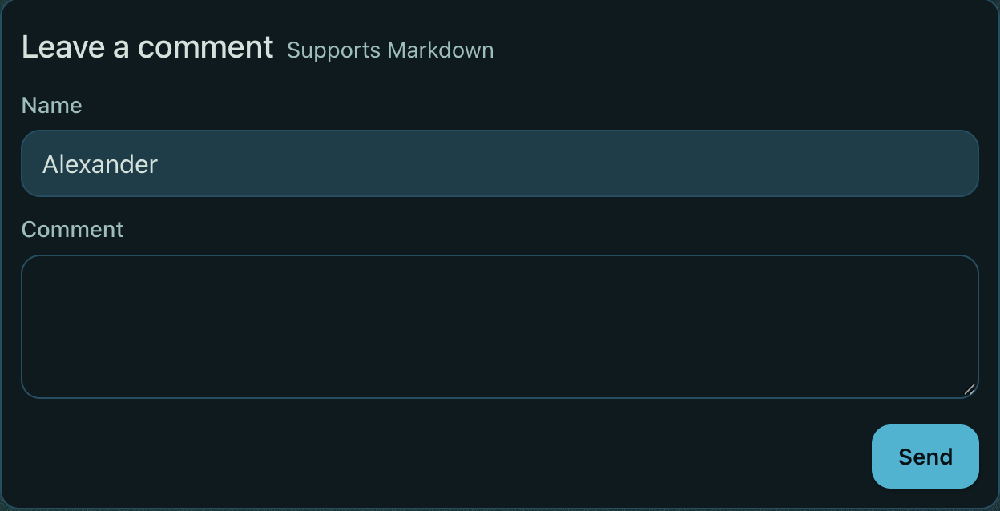
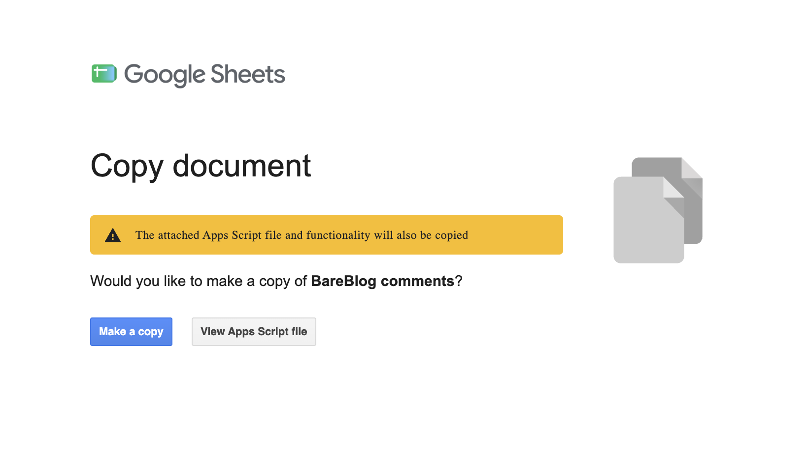
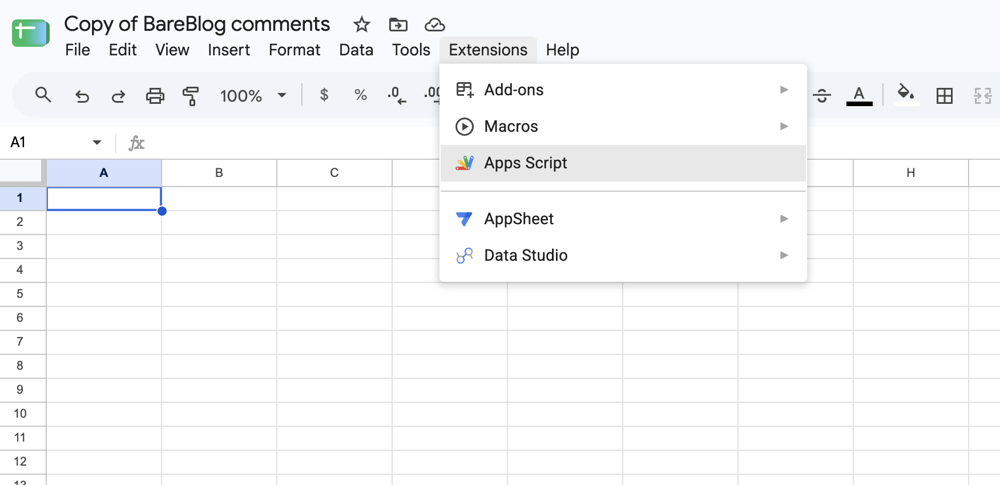
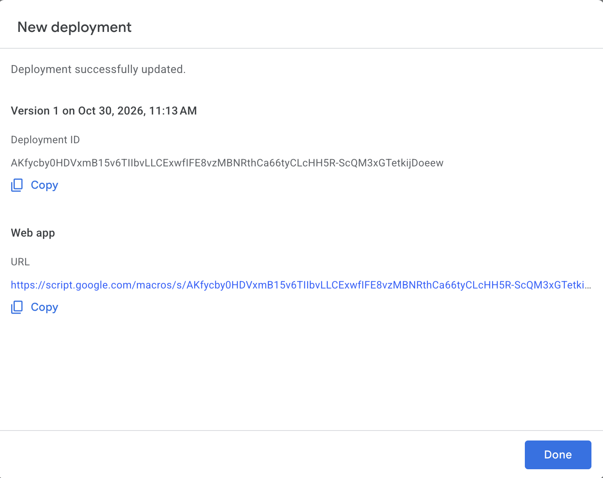
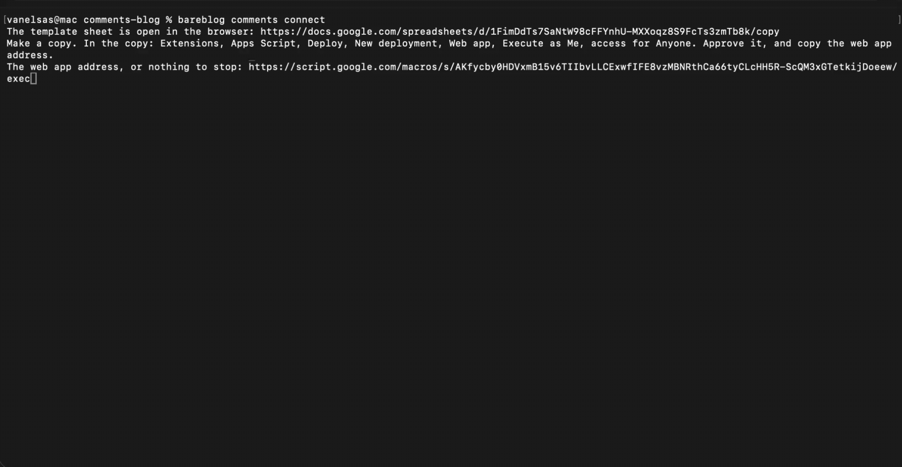
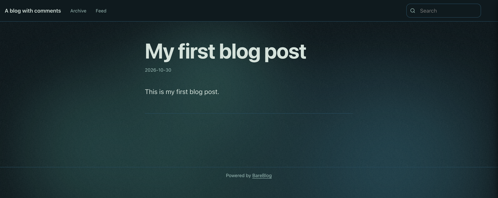
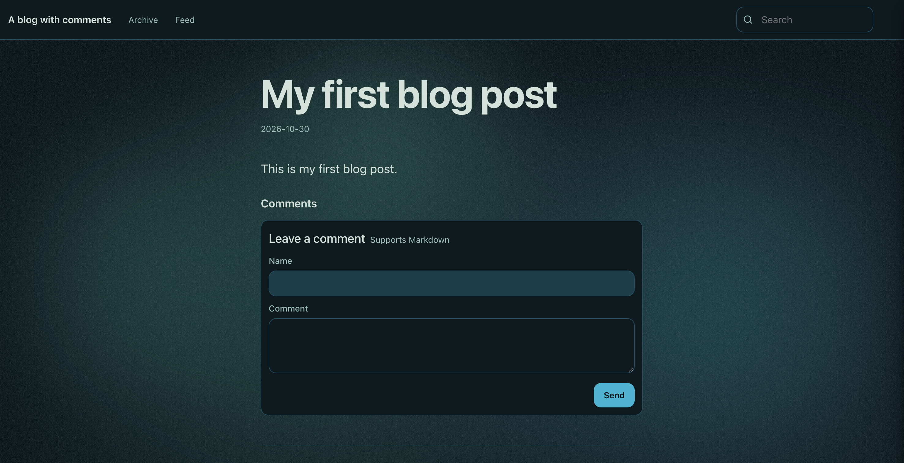
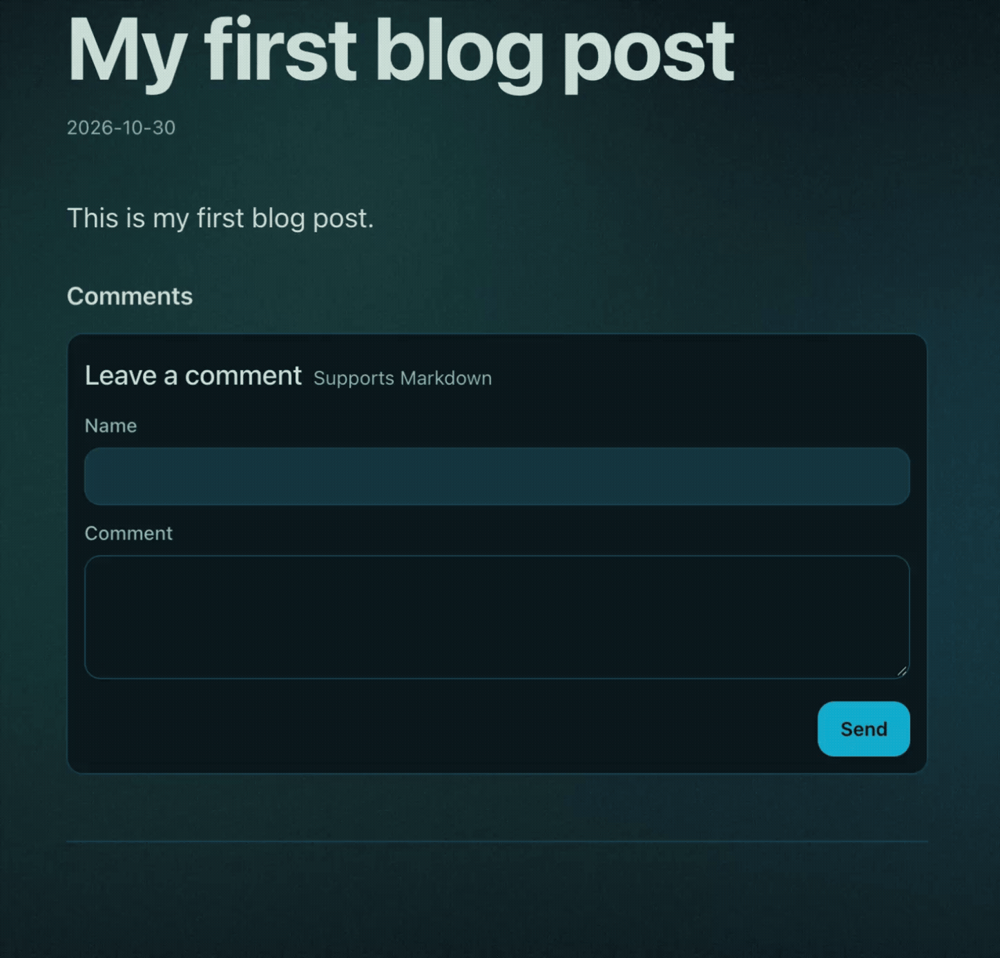
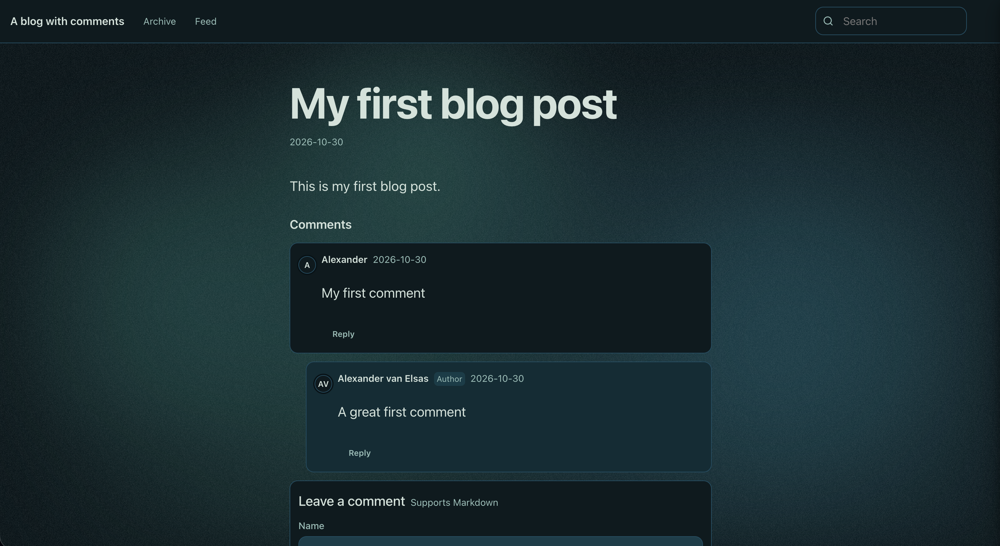

# Static site comments using Babashka and Google Sheets

I wanted to extend my current static blog generator [BareBlog](https://github.com/avanelsas/bareblog) with the possibility to add a comments section. Since the blog is generated as a static site and published to Github Pages, this leaves me with several somewhat unattractive potential solutions.

## Static is not dynamic

The main issue with a static site is that it is just a set of prebuilt HTML, CSS and some JavaScript. It doesn't change if a user interacts with the site. There isn't a way to store the comment without regenerating the site with the comment added to it.

## 3rd party services

There are a few 3rd party services available, but I wanted a free solution, and preferably something that works for anyone, including those that have no idea what GitHub is. This means options like Disqus won't do, but neither do free services like [utterances](https://utteranc.es/) or [gisqus](https://giscus.app/) as they utilize Github issues for their solution.

## Possible technical solutions

### E-mail

First thing that came to mind is use email. What if the user enters a comment in a form, the form sends an email and then a different process picks up the email, processes it and generates the site again adding the new comment?

While it ticks the boxes initially there are some downsides to the solution. The blog owner needs to create a separate email address. Sending email from HTML isn't necessarily reliable, and neither is the email queue. Email could be rejected, lost, delayed etc.

### S3

Instead of email we could send the data to a S3 bucket and process it from there. It would probably be more reliable, but the problem then becomes I also need a submission point.

### A serverless database

Another option is to use Cloudflare Workers with Cloudflare R2. The workers can write to R2 and there is no separate database needed. Or perhaps Netlify Forms. But these solutions aren't free, feel pretty for what I am looking for so there is no use trying that.

## The chosen solution: Google Sheets

It turns out there is a simpler and free solution. We can send the comment to a Google Sheet. And Google Sheet has the option to attach a JavaScript script to it that allows the message sent to be converted to a row in the sheet.

Once the comment is in the sheet we can extract it there from the command line, process it and regenerate the site with the comment attached. It requires a Google account, and a bit of tweaking and configuring but it seems a decent solution that ticks most of the boxes.

**The process:**
1. A reader adds a comment to the blog
2. The blog posts a message to the Google sheet
3. The app script translates the message to a row in the sheet
4. The blog owner picks up the comment, decides if it can be accepted and if so, regenerate the site with the comment attached

While Google Sheets may be known to users, adding scripts and managing the content in the sheet isn't something we do daily. We need a bit of automation to support it.

## The comments section

First, I needed a comments section to add to the blog. The blog is created using [BareBlog](https://github.com/avanelsas/bareblog), an open-source static site generator that is built using web components from a library called [BareDOM](https://github.com/avanelsas/baredom).

Since BareDOM did not have any comment web components I first had to create those. I did not want to build a professional commenting service, but something that can have a design and support comments 3-4 levels deep. I created x-comment (a comment) and x-comments (the container) for that and added it to the library.

Once the comments section is added to the blog, we can use the `x-comments-submit` event to trigger a request to a Google sheet where the message sent is turned into a row in the sheet. And since the web components are from BareDOM they come with theming and support light and dark mode.

## Setting up the Google sheet

I did not like the idea of asking the blog owner to set up a Google sheet and configure it in such a way that it will work for the blog. The solution turned out to be simpler. I can create a template sheet that already includes the app script needed to handle comment messages and simply let the user copy that. There is one task I can't do automated, the script that is part of the sheet must be deployed for it to work.

## Babashka to the rescue

### Setup

After testing the whole setting up the sheet manually there were a few things that could be automated to make life easier for the blog owner. I created a set of [Babaskha](https://babashka.org/) command that guides the user through the setup and handling of comments.

Run `bareblog comments connect` in the command line and it automatically copies a template sheet with the script to the Google account of the blog owner. and opens it.

The only manual step for the user is to open the app script in the sheet and deploy it.

It is a simple enough step and once that is take care of the sheet returns a url that can be used to communicate with the sheet.

That URL is copied back into the `bareblog comments connect` command, still waiting on input. And then the command sets up the sheet, verifies it has access and tests to see if it can write comments to the sheet. It creates a secret to protect calls to the script which it stores locally at `~/.bareblog/comments-secret`.

### Turning comments on

The next step is to turn the comments section on for the blog using `bareblog comments --on`. This will change your blog post from this:

to this:

### Adding a comment

A reader can now add comments to the blogpost he is reading. Since this is a static blog site the comment will not appear automatically. This is fine for now as we want the blog owner to be able to review comments before publishing them. The user gets feedback the comment is sent to the author of the blog for review.

### Handling Comments

When comments are added to the sheet, the blog owner still needs to process them. The first version I have implemented forces the owner to manually approve comments to prevent spam bots from flooding the blog. Maybe at a later stage we can make this a bit more intelligent, but for now each comment needs to be approved.

To do this run `bareblog comments`. It connects to the sheet, sees if there are any comments added and then offers them one by one with a choice what to do. A comment can be accepted, rejected, skipped, or replied to (which means accepting it). The command shows the number of comments to process, the blog post, the comment and the options.

If you approve, the comment is added to the comments section and the site is regenerated. You can decline or skip and also add a direct reply to the comment.

That's it. The site updates and within a few seconds the comment appears on the blog.

There are a few things built in to prevent bots from spamming. The user must enter both a name and a comment for it to be considered, and anything that is posted less than 5 seconds after the page loads is considered a bot comment.

I'm quite happy with the result. It is less techy than using Github issues for the comments, looks much nicer, and the process can be automated reasonably well.

I'm considering adding an option to automatically approve comments or blocks of comments, which then requires some assistance to remove comments from the blog as well. Comments are currently stored in a comments.edn file with the blog post, so they can always be deleted if needed.

You can give it a try right here, as my blog already has implemented support for comments. Let me know what you think in a commment!

#static_site_comments #babaskha #Google_Sheets #Clojure
